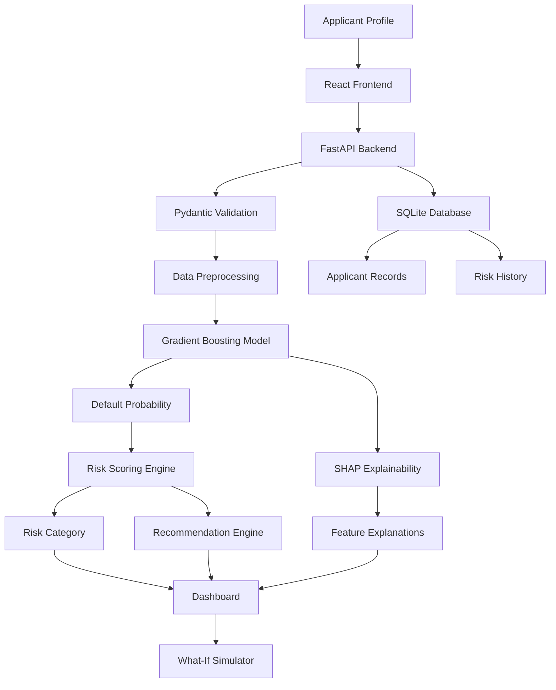

# CreditLens — Adaptive & Explainable Credit Risk Intelligence

CreditLens is an academic credit-risk decision-support application that combines machine learning, explainable AI, financial risk analysis, and interactive simulations to evaluate credit profiles.

The platform estimates the probability of default, generates an interpretable risk score, identifies important factors influencing predictions, and provides recommendations through an interactive dashboard.

Rather than presenting only a prediction, CreditLens aims to make credit-risk assessment more transparent, understandable, and easier to explore.

> **Project Status:** Academic Prototype  
> **Dataset:** Synthetic German Credit Dataset  
> **Domain:** Machine Learning | FinTech | Explainable AI

---

## 1. Project Overview

Traditional credit-risk assessment can be difficult to interpret when systems provide only a final classification without explaining the factors behind it.

CreditLens addresses this problem by integrating predictive machine learning models with explainability techniques and rule-based financial risk analysis.

The application allows users to:

- Assess applicant credit profiles.
- Estimate the probability of default.
- Generate an overall credit-risk score.
- Understand factors influencing individual predictions.
- Explore alternative financial scenarios.
- View applicant assessment history.
- Monitor changes in risk profiles.
- Access model performance and feature insights.

The objective is to make machine-learning-based credit-risk assessment more interpretable and accessible.

---

## 2. Key Features

### Credit Risk Assessment
- Evaluates applicant financial and credit-related attributes.
- Predicts the probability of default using a trained ML pipeline.
- Generates a risk score on a 0–100 scale.
- Categorizes applicants into Low, Medium, High, and Very High risk levels.

### Multi-Dimensional Risk Analysis

CreditLens evaluates multiple dimensions of financial risk:

- Default Risk
- Repayment Capacity
- Financial Stress
- Credit Stability
- Debt Exposure

These dimensions are calculated using a rule-based risk engine and contribute to the overall risk assessment.

### Explainable AI

- Uses SHAP to explain individual model predictions.
- Identifies features that positively or negatively influence predicted default risk.
- Helps users understand the reasoning behind model outputs.

### What-If Scenario Simulator

- Allows users to modify supported financial parameters.
- Simulates changes in loan amount and loan duration.
- Compares original and modified risk scores.
- Displays changes in predicted default probability and risk category.

### Recommendation Engine

- Generates recommendations based on risk categories and financial indicators.
- Provides contextual guidance for reviewing applicant profiles.
- Suggests possible actions based on identified risk factors.

### Applicant Management

- Stores applicant profiles and assessment records.
- Retrieves previously assessed applicants.
- Maintains assessment history using SQLite.
- Displays recent assessments and applicant-level risk information.

### Risk Monitoring

- Tracks recorded changes in applicant risk scores.
- Compares current and previous assessments.
- Provides a view of historical risk progression.

### Model Insights Dashboard

Displays model evaluation metrics, including:

- Accuracy
- Precision
- Recall
- F1-Score
- ROC-AUC
- Confusion Matrix
- Feature Importance

---

## 3. System Architecture

CreditLens follows a frontend-backend architecture with an integrated machine-learning pipeline.



### Workflow

1. The user enters an applicant's financial information.
2. The React frontend sends the information to the FastAPI backend.
3. Pydantic validates the incoming data.
4. The preprocessing pipeline transforms the input features.
5. The trained machine-learning model estimates default probability.
6. The risk engine calculates financial risk dimensions and an overall score.
7. SHAP generates feature-level explanations.
8. The recommendation engine generates contextual guidance.
9. Assessment information is stored in SQLite.
10. Results are presented through the dashboard.

---

## 4. Machine Learning Methodology

### Dataset

CreditLens uses a synthetic German-Credit-shaped dataset containing:

- 1,000 records
- 20 input features
- Binary target variable: `class`
- Target categories: `good` and `bad`

The dataset is intended for educational experimentation and demonstration.

### Data Preprocessing

The preprocessing pipeline includes:

- Separation of input features and target variable.
- Stratified train-test splitting.
- Median imputation for numerical features.
- Most-frequent imputation for categorical features.
- Standard scaling for numerical variables.
- One-hot encoding for categorical variables.

The preprocessing steps are integrated into a Scikit-learn pipeline to maintain consistency between model training and prediction.

### Machine Learning Algorithms

Three classification algorithms are evaluated:

1. Logistic Regression
2. Random Forest Classifier
3. Gradient Boosting Classifier

The final model is selected based on F1-Score, with ROC-AUC used as a tie-breaker.

### Model Evaluation

The following results are recorded in `models/model_metrics.json`.

| Model | Accuracy | Precision | Recall | F1-Score | ROC-AUC |
|---|---:|---:|---:|---:|---:|
| Logistic Regression | 87.0% | 71.8% | 93.3% | 81.2% | 0.968 |
| Random Forest | 91.0% | 86.2% | 83.3% | 84.7% | 0.966 |
| Gradient Boosting | 94.0% | 94.4% | 85.0% | 89.5% | 0.987 |

**Selected Model: Gradient Boosting Classifier**

Gradient Boosting achieved the highest F1-Score and ROC-AUC among the evaluated models.

These results are based on a held-out split of synthetic data and should not be interpreted as evidence of real-world lending performance.

---

## 5. Technology Stack

| Component | Technologies |
|---|---|
| Frontend | React 18, JavaScript, CSS |
| Frontend Build Tool | Vite |
| Backend | Python, FastAPI |
| API Validation | Pydantic |
| Machine Learning | Scikit-learn |
| Explainable AI | SHAP |
| Data Processing | Pandas, NumPy |
| Model Persistence | Joblib |
| Database | SQLite |
| API Documentation | Swagger UI |

---

## 6. Project Structure

```text
CreditLens2/
│
├── backend/
│   ├── main.py
│   ├── database.py
│   ├── schemas.py
│   ├── routes/
│   └── services/
│
├── data/
│   ├── demo/
│   ├── raw/
│   └── processed/
│
├── docs/
│   ├── architecture.md
│   ├── methodology.md
│   └── viva_questions.md
│
├── frontend/
│   ├── src/
│   │   ├── components/
│   │   ├── pages/
│   │   ├── services/
│   │   ├── utils/
│   │   ├── App.jsx
│   │   └── main.jsx
│   └── package.json
│
├── models/
│   ├── creditlens_model.joblib
│   ├── model_metadata.joblib
│   └── model_metrics.json
│
├── notebooks/
│
├── src/
│   ├── explainability/
│   ├── features/
│   ├── models/
│   ├── monitoring/
│   ├── preprocessing/
│   ├── recommendation/
│   ├── risk/
│   └── simulation/
│
├── tests/
│
├── requirements.txt
├── setup_windows.bat
├── start_demo.bat
├── run_backend.bat
├── run_frontend.bat
└── README.md
```

---

## 7. Installation and Setup

### Prerequisites

Ensure the following are installed:

- Python 3.10–3.12
- Node.js and npm
- Git

### Step 1: Clone the Repository

```bash
git clone https://github.com/harshitha349-tech/FinancialRiskPredictor.git

cd FinancialRiskPredictor
```

### Step 2: Set Up the Python Environment

**macOS / Linux**

```bash
python3 -m venv .venv

source .venv/bin/activate

pip install -r requirements.txt
```

**Windows**

```bash
python -m venv .venv

.venv\Scripts\activate

pip install -r requirements.txt
```

### Step 3: Install Frontend Dependencies

```bash
cd frontend

npm install
```

### Step 4: Start the Backend

Open a terminal in the project root:

```bash
python -m uvicorn backend.main:app --reload --port 8000
```

Backend address:

```text
http://127.0.0.1:8000/
```

### Step 5: Start the Frontend

Open another terminal:

```bash
cd frontend

npm run dev
```

Frontend address:

```text
http://localhost:5173/
```

### Step 6: Access API Documentation

FastAPI automatically provides interactive API documentation.

```text
http://127.0.0.1:8000/docs
```

---

## 8. Demo Access

The application includes a demonstration login.

| Field | Credentials |
|---|---|
| Email | demo@creditlens.app |
| Password | CreditLens123! |

Alternatively, select the **Use Demo Account** option on the login screen.

**Note:** The current authentication flow is a frontend demonstration using browser localStorage. It is not production-grade authentication. Do not use real passwords or sensitive personal information.

---

## 9. API Endpoints

CreditLens exposes REST API endpoints through FastAPI.

| Method | Endpoint | Description |
|---|---|---|
| GET | `/` | Service information |
| GET | `/api/health` | Backend health check |
| POST | `/api/predict` | Credit-risk prediction |
| POST | `/api/simulate` | What-if scenario simulation |
| POST | `/api/recommend` | Risk-based recommendations |
| POST | `/api/monitor` | Risk monitoring |
| GET | `/api/applicants` | Retrieve applicant records |
| GET | `/api/applicants/{applicant_id}` | Retrieve applicant details |
| GET | `/api/risk-history/{applicant_id}` | Retrieve risk history |
| GET | `/api/model-metrics` | Retrieve model evaluation metrics |
| GET | `/api/dashboard` | Dashboard summary |

Refer to the interactive Swagger documentation for request schemas and response formats.

---

## 10. Application Screenshots

Screenshots of the running application can be added here.

Create a folder named `docs/screenshots/` and add the following images:

```text
docs/
└── screenshots/
    ├── dashboard.png
    ├── assessment.png
    ├── risk-analysis.png
    ├── simulator.png
    ├── model-insights.png
    └── monitoring.png
```

Embed them in this section using Markdown:

```markdown


```

---

## 11. Testing

The project includes API and core functionality tests under the `tests/` directory.

Run the test suite from the project root:

```bash
pytest
```

If pytest is not installed:

```bash
pip install pytest
```

---

## 12. Limitations and Future Scope

### Current Limitations

- The application uses synthetic demonstration data.
- Risk dimensions and recommendations are based on rule-based logic.
- The authentication system is intended for demonstration only.
- The application has not been validated for real-world lending decisions.
- Production deployment would require additional security, privacy, and model-governance controls.

### Future Enhancements

- Integration with larger, representative and authorised financial datasets.
- Model calibration and external validation.
- Fairness and bias evaluation across applicant groups.
- Secure authentication and role-based access control.
- Advanced model-drift detection and monitoring.
- Cloud deployment and scalable infrastructure.
- Automated model retraining and evaluation pipelines.

---

## 13. Responsible Use

CreditLens is an academic prototype developed for educational and demonstration purposes.

Its predictions, risk scores, and recommendations are not financial advice and must not be used as the sole basis for approving, rejecting, or pricing real credit applications.

Any real-world use would require representative data, independent validation, fairness assessment, regulatory review, privacy safeguards, and qualified human oversight.

---

## 14. Author

**Harshitha Yamsani**

B.Tech — Artificial Intelligence and Data Science

GitHub: [@harshitha349-tech](https://github.com/harshitha349-tech)

Repository: [FinancialRiskPredictor](https://github.com/harshitha349-tech/FinancialRiskPredictor)

---

**CreditLens — Making Credit Risk Assessment More Transparent, Explainable, and Accessible.**

